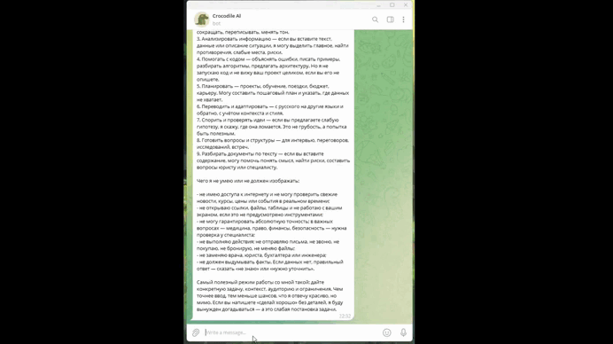

# 🤖 ИИ-Ассистент Telegram

Интеллектуальный Telegram-бот на базе оркестратора n8n и языковой модели DeepSeek Chat, предназначенный для ведения связного контекстного диалога и оперативного решения повседневных прикладных задач. Сценарий обрабатывает входящие текстовые запросы в реальном времени, сохраняет историю сессии каждого пользователя и генерирует фактологически точные ответы без жестких кнопочных сценариев.

## 🚀 Ключевые возможности

- **Сохранение контекста сессий:** Использование оконного буфера памяти (`Window Buffer Memory`) с привязкой к `chat.id` для поддержания логики беседы.
- **Интеграция с DeepSeek Chat:** Использование модели `deepseek-chat` через фреймворк LangChain внутри n8n для быстрой обработки текстовых данных.
- **Системный промптинг роли:** Предустановленный системный промпт для фактчекинга, профессионального тона, аргументированного спора и разбора слабых мест в рассуждениях.
- **Минималистичная отказоустойчивая архитектура:** Сквозной пайплайн из 4 функциональных узлов с мгновенной диспетчеризацией ответов в Telegram-чат.

## 🛠 Быстрый старт и установка

### Предварительные требования

- Развернутый экземпляр n8n (версия с поддержкой расширенных LangChain-узлов: self-hosted или Cloud).
- Токен Telegram Bot API (получается через `@BotFather`).
- API-ключ DeepSeek с положительным балансом счета.

### Пошаговый запуск

**👉[Скачайте готовый JSON-шаблон](telegram_ai_assistant_template.md)**

1. **Импорт сценария:**
   - Откройте интерфейс n8n.
   - Перейдите в раздел **Workflows** -> **Import from File...** и выберите файл `telegram_ai_assistant_template.json` (или вставьте его JSON-содержимое).
2. **Настройка учетных данных (Credentials):**
   - В узле **Telegram Trigger** выберите или добавьте связку учетных данных **Telegram API** (укажите API Token).
   - В узле **Send a text message** привяжите ту же учетную запись Telegram.
   - В узле **DeepSeek Chat Model** настройте учетные данные **DeepSeek API** (укажите API Key).
3. **Кастомизация роли (опционально):**
   - Откройте узел **AI Agent** и при необходимости отредактируйте поле `System Message` под специфику ваших задач.
4. **Активация:**
   - Переключите статус сценария в верхнем правом углу из положения **Inactive** в **Active**.

## 🛡 Обработка краевых случаев (Edge Cases)

| Сценарий | Поведение системы | Результат |
| :--- | :--- | :--- |
| **Смена темы или новый вопрос в рамках диалога** | Буфер `Simple Memory` сопоставляет сообщение с историей по ключу `{{ $json.message.chat.id }}` | Модель учитывает предыдущие реплики без смешивания контекстов разных пользователей |
| **Параллельные запросы от нескольких пользователей** | Триггер изолирует полезную нагрузку каждого входящего события по индивидуальному идентификатору сессии | Параллельная независимая обработка без утечки данных между сессиями |
| **Сложный/многосоставный запрос на анализ или фактчекинг** | Системный промпт агента блокирует генерацию вымышленных фактов и принуждает к структурированному ответу | Выдача детального ответа с разбором неточностей и слабых мест аргументации |

## 📊 Метрики эффективности

| Параметр | Значение | Примечание |
| :--- | :--- | :--- |
| **Время отклика (Latency)** | ~1.5 – 3.5 сек | Зависит от объема входящего контекста и серверной задержки API DeepSeek |
| **Себестоимость запроса** | ~$0.0001 – $0.0005 | Оптимальное потребление токенов за счет сбалансированного размера контекстного окна |
| **Расход ресурсов n8n** | Минимальный | Отсутствие тяжелых промежуточных трансформаций данных и внешних баз данных |

## 📬 Контакты

- **Автор:** Kodzhi Tanaka
- **Telegram:** [@TanakaKodzhi](https://t.me/TanakaKodzhi)
- **Telegram-канал:** [Build -> Запуск](https://t.me/tanaka_dev)
